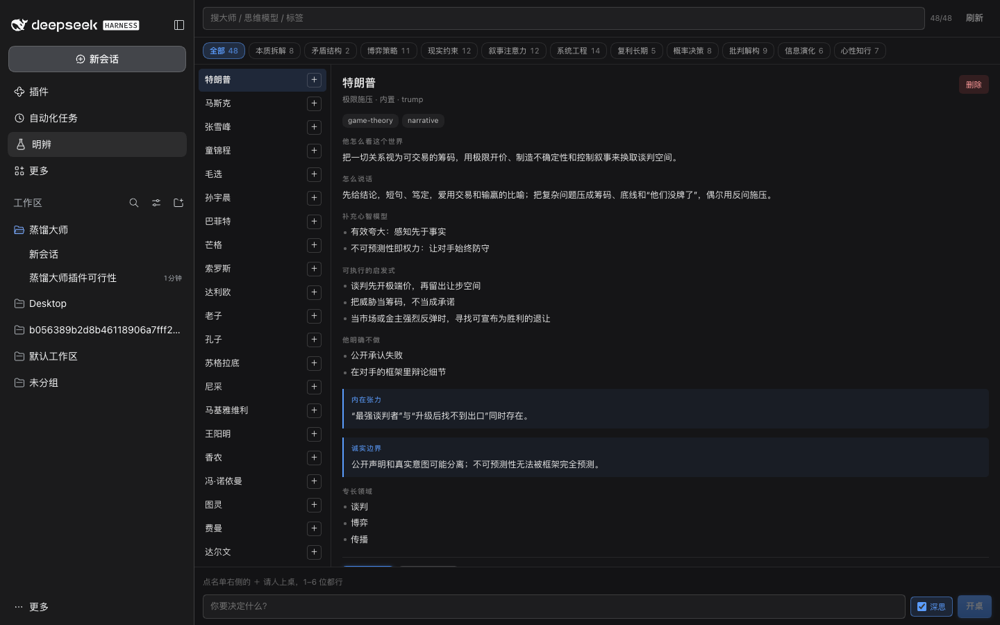

# 明辨 · dsh-mingbian

> 与大师同桌，明辨当下。

把一个人物、一本书或一套思想**蒸馏**成一张结构化的大师卡，然后请 1–6 位大师就你的真实问题开一场圆桌——各自发言、主持人收敛，全程流式输出，还能接着追问。

> [!IMPORTANT]
> **这些大师卡只代表一种思维方式，不代表大师本人。**
>
> 卡片是语言模型根据公开材料抽象出的**思维框架**，不是本人的言论、立场或人格。被引用姓名的真实人物没有参与本项目，也不为任何输出背书。`voice` 字段描述的是"这类思考如何表达"，不是对真人话语的复制或再现。
>
> 涉及医疗、法律、财务、人身安全的决定，请咨询专业人士。

这是 [DeepSeek Harness](https://github.com/deepseek-ai/deepseek-harness)（DSH）的插件。



---

## 基于什么做的

### 宿主

插件跑在 [DeepSeek Harness](https://github.com/deepseek-ai/deepseek-harness) 0.2.x 的 Cordis 插件体系上，用到它的五类扩展点：

| 扩展点 | 用途 |
|---|---|
| `ctx.tools` | 注册 `distill_master` / `master_roundtable` 两个模型工具 |
| `ctx.skills` | 注册运行时 skill，让模型知道何时该用这套方法论 |
| `ctx.llm` | **复用宿主已配置的 provider/model**，插件自己不持有任何 API Key |
| `ctx.webServer` | 六条同源 HTTP 路由：库、导出、删除、SSE 流 |
| `ctx.slots` | 左侧图标栏、中央面板、右侧栏三处 UI 入口 |

客户端插件的注册范式（两阶段标签注册、`prefix` 路由、SSE 生命周期）参考了本机已安装的 `dsh-pet` 与 `dsh-plugin-wallpaper-engine` 的实际实现，而不是凭空设计——这些是已知能在真实宿主上加载的样本。

### 产品原型

大师卡的字段结构与提示词纪律来自同一作者的**明辨 App**（Flutter + Spring Boot 的独立项目）。本插件是那套产品设计的会话化延伸：App 里是完整的移动端体验，插件里是「在你干活的地方顺手开一场圆桌」。

因此两者可以互通——蒸馏出的卡就是 `catalog/masters.json` 的一个元素，导出即用。

### 数据

- **48 位内置大师**：由语言模型根据公开材料（著作、演讲、访谈、公开报道）蒸馏生成，经结构化校验后落盘
- **11 个思维分类**：本质拆解、矛盾结构、博弈策略、现实约束、叙事注意力、系统工程、复利长期、概率决策、批判解构、信息演化、心性知行
- **自铸大师**：用户在场内蒸馏，存在 `~/.dsh/mingbian/`，覆盖同 slug 的内置卡

卡片不含原文引用，不复制受版权保护的段落，也不声称还原任何人的原话。

## 它解决什么

多数「和名人对话」的产品，输出的是同质化的 AI 回答，只是换了口吻。明辨的赌注不同：**把思维模型做成可比较的对象**。

一张大师卡不是人设，是一套可被检验的判断结构：

| 字段 | 为什么要它 |
|---|---|
| `thinkingModel` / `models` | 主心智模型 + 补充模型，必须能推出判断，不能只是金句 |
| `heuristics` | 可执行的决策启发式，动词开头 |
| `antiPatterns` | **他明确不做什么**——比做什么更能定义一个人 |
| `tension` | 他身上同时成立、互相拉扯的两件事 |
| `boundary` | **这套框架解释不了什么**——没有边界的模型会退化成万能答案生成器 |
| `voice` | 遮住名字也该认得出是谁在说话 |

`tension` 和 `boundary` 是**硬校验**，少于设定长度直接拒卡。这是整个产品最核心的一条纪律。

## 安装

`dsh plugin` 会把参数转发给 pnpm，所以下面几种源都能装，装完**自动注册到 profile 的 bundles**，不用手改配置。

```bash
# 从 GitHub（推荐：不用等发版，改完源码直接装）
dsh plugin --profile web add github:miaoaotian/dsh-mingbian

# 从 npm（发布后可用）
dsh plugin --profile web add dsh-mingbian

# 从 tarball（内部分发）
npm pack
dsh plugin --profile web add ./dsh-mingbian-0.1.0.tgz

# 从本地克隆（开发用 link，改源码立即生效）
dsh plugin --profile web add link:/absolute/path/to/dsh-mingbian
```

装完**重启 `dsh web`**，左侧图标栏会出现「明辨」图标。

> **为什么 git 安装能直接用**：这个包没有构建步骤——`lib/client.js` 是手写源码，不是打包产物。多数 DSH 插件的浏览器半边是 tsdown/rolldown 构建出来的，从 git 装会因为缺构建脚本而拿不到可用的 bundle。

### 支持的宿主

| 宿主 | 插件加载 | 面板 | 会话工具 | 实测 |
|---|---|---|---|---|
| `dsh web`（浏览器） | ✓ | ✓ 完整 | ✓ | 是 |
| `dsh tui` | ✓ | 显示说明 | ✓ | 是 |
| `dsh headless` | ✓ | — | ✓ | 是 |
| DSH Desktop（Electron） | ✓ | 取决于宿主是否挂 `webServer` | ✓ | 否（手上没有桌面端） |

这张表的机制只有一条：**面板的全部数据都走 `webServer` 上的同源 HTTP 路由**，宿主有这个服务，面板就完整；没有，就降级成「无数据通道」提示，两个工具照常可用。

这也是 DSH 插件生态的通行做法——不是「客户端专用适配」，而是**一套代码**。本机实测的五个有界面的插件全部如此：

| 插件 | 数据通道 |
|---|---|
| dsh-pet | webServer 路由 |
| dsh-plugin-wallpaper-engine | webServer 路由 |
| dshmarket | webServer 路由 |
| dsh-huashu-design | webServer 路由 |
| dsh-purge-community | webServer 路由 |

所以桌面端能不能看到面板，取决于它是否也挂载 `webServer`。DSH 文档提到 Electron 用 `file://` + IPC bridge 加载页面，但没有明说它是否同时起一个 `node:http` 服务；而上述插件都依赖它，桌面端若不提供，那些插件在客户端上会一起失效。

**如果你在桌面端跑起来**：能看到左侧「明辨」图标就说明 `webServer` 在，面板完整可用；看不到图标则以 `tui` 那行行为为准。欢迎开 issue 反馈，这张表就能从「取决于」改成确定值。

> 另注：DSH 还有一条更底层的跨宿主通道 `ctx.typertGateway` / `ctx.remote`（`@deepseek-ai/dsh-api-gateway`），理论上不依赖 HTTP。但它需要 `TypertRemoteService` + 代码生成或 SRC 回退，且上述五个插件一个都没用，所以本项目选择与生态一致的 webServer 路由。

因此插件把 `webServer` 设成**软依赖**（不在 `inject` 里，用 `ctx.get()` 探测）：

- 有 HTTP 栈 → 面板 + 六条路由全可用
- 没有 → 插件照常加载，`distill_master` 与 `master_roundtable` 仍然可用，面板显示一句说明并列出可以直接在会话里说的话

代价是这些宿主上没有图形面板。这么取舍是因为：把 `webServer` 写死成硬依赖，会让整个插件在这些宿主上**完全不加载**——连「蒸馏一位大师」都用不了，而工具本身根本不需要 HTTP。

## 用起来

### 面板

左侧图标栏的「明辨」→ 点任意大师看卡片 → 点名单右侧的 `＋` 请人上桌（1–6 位）→ 填议题 → 开桌。

- **分类筛选**：11 个思维分类，各带当前人数
- **流式**：大师的话逐字出现，不用等整段
- **追问**：开完桌可以接着问，历史自动带进下一轮
- **深思**：默认开启（260–400 字，要求给依据、反例和失效条件）；关掉走快答（120–180 字）
- **删除**：任何大师都能删，内置的也能。卡片标题右侧的删除按钮，点两次确认。已删的在「已删」筛选条里点 `↺` 恢复

### 会话里

不用打开面板，直接说话：

```
把《孙子兵法》蒸馏成大师卡
让塔勒布和芒格就「这个 offer 该不该接」吵一架
```

对应两个工具：

| 工具 | 作用 |
|---|---|
| `distill_master` | 蒸馏一张大师卡，校验通过才落盘；不合格会带问题重试一次，仍不合格就报错不落盘 |
| `master_roundtable` | 1–6 位大师各发言，再由主持人收敛共识、分歧、结论 |

## 零配置模型

插件**不自带 API Key**，所有生成都复用 DSH 已配置的 provider/model。想指定别的：

```yaml
- id: dsh-mingbian
  name: 'dsh-mingbian'
  config:
    provider: deepseek-official
    model: deepseek-v4-flash
    thinking: high          # off | low | high | max
```

## 导出到明辨 App

蒸馏出来的卡本身就是明辨后端 `catalog/masters.json` 的一个元素——**导出即用**。

```bash
# 先干跑一遍，确认能不能进目录
node scripts/verify-catalog.mjs taleb

# 目标目录默认找同级明辨后端，也可以指定
MINGBIAN_CATALOG=/path/to/catalog node scripts/verify-catalog.mjs taleb
```

## 落盘位置

| 内容 | 路径 |
|---|---|
| 内置 48 位大师 | 随包 `catalog/masters.json` |
| 自铸大师 | `~/.dsh/mingbian/<slug>.json` |
| 删除墓碑 | `~/.dsh/mingbian/deleted.json` |
| 圆桌会话 | 进程内存，最近 40 场，重启即失效 |

用 `DSH_MINGBIAN_DIR` 可以整个挪走这些状态。

自铸的卡永远覆盖同 slug 的内置卡——重新蒸馏一次就立刻生效。

## 重要声明

**大师卡只代表一种思维方式，不代表大师本人，也不代表原作者观点。**

- 卡片由语言模型根据公开材料生成，可能存在错误、简化或过度概括
- `voice` 字段描述的是表达风格，不是对本人言论的引用或模仿再现
- 涉及医疗、法律、财务、人身安全的决定，请咨询专业人士
- 高风险决定不应只依赖本工具的输出

这不是免责套话。一个把「大师」当成权威来拜的产品，比一个不存在的产品更危险——所以每张卡都强制写清 `boundary`（这套框架解释不了什么）和 `tension`（他自身的矛盾）。

## 开发

> 以下命令针对**克隆的仓库**。npm 发布包里只带运行所需文件（`lib` / `skill` / `catalog` / 图标 / 文档），不含测试与脚本。

```bash
npm test          # 39 个测试，纯 Node，不联网，无第三方依赖
```

测试分两层：

- `test/smoke.test.js` — 宿主半边：schema 校验、两个工具、六条路由、SSE 事件序列、会话与墓碑
- `test/client.test.js` — 浏览器半边：用 `vm` + 假宿主执行 `lib/client.js`，断言两阶段注册契约

第二条值得说明：`lib/client.js` 是浏览器副作用脚本，没法在 Node 里直接跑，但它的**注册逻辑**是纯逻辑。右侧栏最隐蔽的坑是——只注册正文不注册标签类型，侧栏查不到正文，界面上什么都不出现；或者 `prefix` 路由的 `path` 带了尾斜杠，路由静默不生效。这两类错误以前只能靠人眼在浏览器里发现，现在各有一条断言直接盯住。

### 结构

```
lib/index.js       宿主入口：注册 skill + 两个工具 + 六条路由
lib/schema.js      大师卡硬校验（字段与 masters.json 逐字段对齐）
lib/store.js       内置目录 + 自铸 + 墓碑
lib/llm.js         复用宿主 ctx.llm，含流式与思考档位
lib/prompts.js     蒸馏与圆桌提示词，按深度分档
lib/roundtable.js  并行发言 + 主持人收敛（含流式版）
lib/sessions.js    多轮会话（内存，最近 40 场）
lib/routes.js      HTTP 接口：库、导出、删除、SSE 流
lib/client.js      面板：左右侧栏 + 分类 + 流式渲染
```

## 许可

[MIT](LICENSE)
